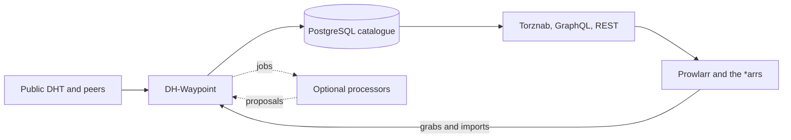

<h1 align="center">DH-Waypoint</h1>

<p align="center">
  <strong>A self-hosted BitTorrent DHT crawler and indexer for the *arr stack.</strong><br>
  Descended from bitmagnet, it learns from what your *arrs grab and serves its catalogue over Torznab, GraphQL and REST.
</p>

<p align="center">
  <a href="https://norvitech.com"></a>
  <a href="https://github.com/spencernorton/DH-Waypoint/actions/workflows/ci.yml"></a>
  <a href="https://github.com/spencernorton/DH-Waypoint/releases"></a>
  <a href="#install"></a>
  <a href="LICENSE"></a>
  <a href="https://buy.stripe.com/8x26oH2U44f65TRe574wM04"></a>
</p>



DH-Waypoint crawls the public BitTorrent DHT, keeps the torrent metadata it
finds in PostgreSQL and serves it to Prowlarr, Sonarr, Radarr, Lidarr and
Readarr as a Torznab indexer. Webhooks from those apps tell it what you
actually grabbed and imported, and that evidence outranks anything it guesses.
It is a headless Go service with no browser interface, forked in April 2026
from [bitmagnet](https://github.com/bitmagnet-io/bitmagnet).

## What it does

**It indexes v1 and v2 torrents.** The crawler samples the DHT (BEP 5 and 51)
and fetches metadata from peers (BEP 9 and 10); v1, pure v2 and hybrid torrents
keep their complete identities, and `.torrent` files can be imported directly.
Payloads are never downloaded, and opt-in BEP 15 tracker scrapes keep seeder
counts current.

**Your \*arr stack is the ground truth.** \*arr webhooks, an \*arr history
poller and a qBittorrent poller record what you grab and import in an
append-only evidence ledger, and a label backed by a real grab overrides the
classifier.
Opt-in success priors and liveness tracking then re-rank Torznab results and
drop dead swarms.

**Processing is as light as you want.** `PROCESSING_MODE=basic`, the default,
stamps a coarse category from file extensions; `full` adds the deterministic
classifier with anime-aware title parsing and TMDB matching; `raw` stores
metadata untouched. Templates in [`plugins/`](plugins/README.md) add a regex
classifier, the [Armiger](https://github.com/spencernorton/armiger) model or a
model hosted on OpenRouter, each turned on in at most three steps. Plugins only
propose: the core validates every proposal and never lets one delete a record.

**Curation hides; it does not delete.** Content filtering and retention
report what they would remove through `would_*` metrics, while the opt-in
adult filter and name policy keep releases out of Torznab and GraphQL results
without deleting them. A CSAM blocklist, fed from
lists you choose, is checked before any metadata fetch. For RAM- or disk-constrained hosts, the opt-in [**LEAN MODE** plugin](docs/lean-mode.md) (`plugins/lean-mode/`, disabled by default) keeps only the single best release per movie or TV episode across `observe`, `serve`, and double-locked `prune` modes.

**The APIs are standard and bounded.** Torznab for the \*arrs, GraphQL over
JSON `POST`, a REST read API with an OpenAPI document, and a raw REST v2
catalogue. Request bodies, selections and page sizes are capped before any
resolver runs, and catalogue work stops at a 30-second deadline.

**You can see what it is doing.** Every subsystem exports `dh_waypoint_*`
Prometheus metrics, `pgstats` reports table bloat, vacuum lag and pool
saturation, and Grafana dashboards ship in [`observability/`](observability/).

## Install

### Docker — Docker Compose

```sh
git clone https://github.com/spencernorton/DH-Waypoint.git
cd DH-Waypoint
cp examples/.env.example .env    # set POSTGRES_PASSWORD; nothing else is required
docker compose up -d
docker compose exec dh-waypoint dh-waypoint doctor
```

This runs the published `ghcr.io/spencernorton/dh-waypoint` image, the companion
`ghcr.io/spencernorton/dh-waypoint-tms` (`dh-tmsd`) Rust search sidecar (pin a
release with `DH_WAYPOINT_VERSION`), and PostgreSQL 16, with HTTP on port 3333
and the peer protocol on 3334 TCP and UDP. Add `http://<host>:3333/torznab/`
as a Torznab indexer in Prowlarr or each \*arr ([per-app guides](docs/integrations/prowlarr.md)),
and point their webhooks at `http://<host>:3333/evidence/arr/<instance>` with
the `EVIDENCE_WEBHOOK_SECRET` from your `.env` ([evidence](docs/evidence.md)).
The port is published on `127.0.0.1` only: for clients on another host or in
another Compose project, set `TORZNAB_API_KEY` and `HTTP_SERVER_API_KEY`, then
`DH_WAYPOINT_HTTP_BIND=0.0.0.0` ([security](docs/operations/security.md)).

### From source

`examples/docker-compose.public.yml` builds the image from your checkout and
runs in `full` mode; [the quickstart](docs/quickstart.md) covers both stacks.

The published `dh-waypoint` and `dh-waypoint-tms` images are multi-arch (`linux/amd64` and `linux/arm64`), and there is no browser interface,
account system or hosted site here. The optional plugin services build from
your checkout when their Compose profile is on; they have no published images.

## Upgrading and optional ParadeDB (PG 18) search

Existing `postgres:16-alpine` and stock `postgres:18` installs **do not need a database migration** to upgrade DH-Waypoint — schema migrations run in place on startup and search continues on stock `tsquery` (`SEARCH_BM25_MODE=auto`).

Migrating to [ParadeDB (`paradedb/paradedb:0.26.6-pg18`)](docs/paradedb-bm25.md) is **100% opt-in**. Operators choose it for native BM25 Top-K relevance ranking and to reclaim multi-gigabyte storage bloat after online file-bundle compaction (real production benchmark: `100.0 GiB` compacted PG 16 → `66.7 GiB` PG 18 *including* the BM25 index). Because PG 16 Alpine (`musl`) cannot be upgraded in place to PG 18 (`glibc`), migrating uses a logical dump/restore into a fresh volume while leaving your original PG 16 volume untouched as a rollback copy — taking roughly **24 seconds** for ~130K torrents, **46 seconds** for ~345K torrents, or **~46 minutes** of data cutover (**~84 minutes** including BM25 index build) for a 15.8M-torrent catalogue. See the [ParadeDB BM25 & migration guide](docs/paradedb-bm25.md) for the full step-by-step walkthrough.

## Documentation

- [Documentation index](docs/index.md): every guide in one place
- [Upgrading to v6.0](docs/migration-v6.md): fail-closed upgrade guard, zero-manual-step `v5.12`–`v5.15` upgrade, and default-on `dh-tmsd` search sidecar
- [ParadeDB BM25 search & optional PG 16 → PG 18 migration](docs/paradedb-bm25.md): why to migrate, step-by-step cutover, rollback, and measured timings
- [Quickstart](docs/quickstart.md) and [configuration](docs/configuration.md)
- [API guide](docs/api-guide.md), with [Torznab](docs/reference/torznab-api.md), [GraphQL](docs/reference/graphql-api.md), [metrics](docs/reference/metrics.md) and [CLI](docs/reference/cli.md) references
- [Evidence](docs/evidence.md): wiring the \*arrs and qBittorrent into labels, ranking and liveness
- [LEAN MODE plugin](docs/lean-mode.md): opt-in single-best-release curation and disk compaction for RAM/disk-constrained hosts
- [Plugins](plugins/README.md): the three templates, [plugin files](docs/processors/plugin-files.md), the [v1 protocol](docs/processors/v1.md), the [LLM processor](docs/processors/llm.md) and [Armiger](docs/armiger-integration.md)
- [BitTorrent v2](docs/bittorrent-v2.md): identities, the raw REST v2 catalogue and processor compatibility
- [Architecture](docs/architecture.md) and [operations](docs/OPERATIONS.md): internals, capacity, backups and upgrades
- [Benchmarks](docs/project/benchmarks.md) and [what changed from bitmagnet](docs/project/improvements.md)
- [Legal disclaimer](docs/legal/disclaimer.md) and [CSAM defence](docs/csam-defense.md)
- [Changelog](CHANGELOG.md) and [release process](docs/RELEASING.md)

## Where your data lives

| Path | Purpose |
|---|---|
| `dh-waypoint-postgres` volume | The database: catalogue, evidence ledger, queues and processor state |
| `dh-waypoint-config` volume, `/var/lib/dh-waypoint/config/bitmagnet` | Optional `config.yml` and `classifier.yml` |
| `dh-waypoint-data` volume, `/var/lib/dh-waypoint/data/bitmagnet` | Rotated log files, when file logging is enabled |
| `dh-waypoint-tms-db` & `dh-waypoint-tms-wal` volumes | Compact mmap search index and WALs for the default-on `dh-tmsd` sidecar (rebuilt automatically from PostgreSQL if empty) |
| `./plugins`, read-only | The plugin files that register processors |

The crawler joins the public DHT and connects to peers, which see this host's
IP address. Trackers, TMDB, blocklist feeds and exports, your \*arrs and
processors are contacted only when you configure them.

## Contributing and support

- Bugs and ideas: [open an issue](https://github.com/spencernorton/DH-Waypoint/issues/new/choose). Questions: [Discussions](https://github.com/spencernorton/DH-Waypoint/discussions).
- Security: [report a vulnerability privately](https://github.com/spencernorton/DH-Waypoint/security/advisories/new) ([SECURITY.md](SECURITY.md)). There is no e-mail address; that is deliberate.
- Code: read [CONTRIBUTING.md](CONTRIBUTING.md) first. Pull requests are reviewed and squash-merged here, and changes ship in tagged releases.
- If DH-Waypoint earns a place in your stack, you can [support its development](https://buy.stripe.com/8x26oH2U44f65TRe574wM04).

## Development

```sh
go vet ./...
go test -race ./...
python3 scripts/check_headless_boundary.py
python3 scripts/check_processor_boundary.py
task build    # ./DH-Waypoint, versioned from VERSION
task lint
```

PostgreSQL integration tests run when `DH_WAYPOINT_TEST_POSTGRES_DSN` points at
a disposable database ([development setup](docs/development/setup.md)).

## Licence

[MIT](LICENSE) © 2023 bitmagnet contributors, © 2026 DH-Waypoint contributors.

DH-Waypoint is a fork of [bitmagnet-io/bitmagnet](https://github.com/bitmagnet-io/bitmagnet)
at [`2b9e8ea`](https://github.com/bitmagnet-io/bitmagnet/commit/2b9e8eadd34c037830d1fa7470b5ef2746cd6388)
and keeps its licence and notices ([NOTICE](NOTICE)). The DHT crawler, metadata
fetcher, CEL classifier and the PostgreSQL and GraphQL foundations are
upstream's work.

---

<p align="center">
  <a href="https://norvitech.com"></a>
</p>

<p align="center">
  <a href="https://github.com/spencernorton/helios">Helios</a> ·
  <a href="https://github.com/spencernorton/DH-Waypoint">DH-Waypoint</a> ·
  <a href="https://github.com/spencernorton/armiger">Armiger</a> ·
  <a href="https://github.com/spencernorton/arrmes">Arrmes</a> ·
  <a href="https://github.com/spencernorton/endexis">Endexis</a> ·
  <a href="https://github.com/spencernorton/xnote">XNote</a> ·
  <a href="https://github.com/spencernorton/xnote-placement">XNote Placement</a> ·
  <a href="https://github.com/spencernorton/snipsnap">SnipSnap</a> ·
  <a href="https://github.com/spencernorton/conductor">Conductor</a> ·
  <a href="https://github.com/spencernorton/norvi-os">NorviOS</a> ·
  <a href="https://github.com/spencernorton/indigo">Indigo</a> ·
  <a href="https://github.com/spencernorton/roadtrack">Road Track</a> ·
  <a href="https://norvitech.com">norvitech.com</a>
</p>
