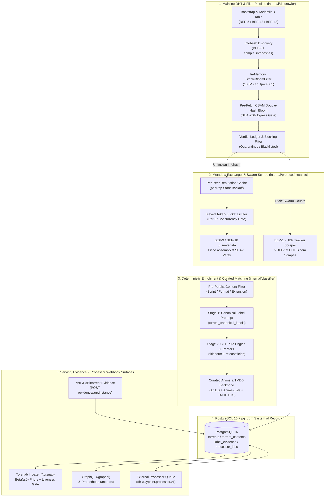

# DH-Waypoint Core Architecture Guide

DH-Waypoint is a high-throughput, model-independent BitTorrent DHT crawler, metadata exchanger, enrichment engine, and Torznab/GraphQL indexer written in Go. It is designed to operate as a self-contained backend (`ghcr.io/spencernorton/dh-waypoint`) backed by PostgreSQL 16 (`pg_trgm` + full-text `tsvector`), while delegating optional neural or statistical classification and safety-gating passes to isolated processor services over the bounded [`dh-waypoint.processor.v1`](processor-contract.md) HTTP webhook contract.

---

## 1. Mainline DHT Crawler Pipeline (`BEP 5` / `BEP 51`)

The discovery engine (`internal/dhtcrawler`, `internal/protocol/dht`) participates directly in the global Mainline Kademlia Distributed Hash Table over UDP without relying on centralized feeds or public tracker lists.

### Protocol Implementation Matrix

| Specification | Package | Architectural Role |
|---|---|---|
| **BEP 5** (Mainline DHT) | `internal/protocol/dht/server`, `ktable` | Prefix-bucket Kademlia routing table (`K=20`), `ping`, `find_node`, `get_peers`, and `announce_peer` KRPC exchange. |
| **BEP 51** (DHT Infohash Indexing) | `internal/dhtcrawler/sample_infohashes.go` | Primary high-velocity discovery fast path. Queries responsive neighbors with `sample_infohashes` against a rotating 160-bit target (`soughtNodeID`, rotated every `10s`). |
| **BEP 42** (DHT Security Extension) | `internal/protocol/dht` | Derives the 20-byte node ID deterministically from the external IP (`CRC32C` masked prefix) for anti-Sybil compliance. When booting with a non-BEP-42 fallback ID (`randomFallback=true`), outbound `sample_infohashes` probes pause until external-IP verification completes. |
| **BEP 43** (Read-Only DHT Nodes) | `internal/protocol/dht/server` | Marks outbound KRPC packets with the read-only flag (`ro=1`) so remote nodes do not waste storage announcements on the crawler. |
| **BEP 33** (DHT Scrapes) | `internal/dhtcrawler/scrape.go` | Extracts 256-byte `bfsd` (seeds) and `bfpe` (peers) Bloom filters from `get_peers` responses to estimate swarm cardinality without joining the swarm. |

### Concurrency & Channel Pipeline

`crawler.start()` (`internal/dhtcrawler/crawler.go`) orchestrates 15 concurrent goroutine stages connected via typed, backpressure-aware `BufferedConcurrentChannel` and `BatchingChannel` primitives (`internal/concurrency`):

1. **Bootstrap & Node Discovery (`runPing`, `runFindNode`, `reseedBootstrapNodes`):** Seeds the routing table from deterministic routers (`dht.transmissionbt.com:6881`, `router.bittorrent.com:6881`, `router.utorrent.com:6881`) and transitions to self-sustaining Kademlia traversal.
2. **Infohash Sampling (`runSampleInfoHashes`, `getNodesForSampleInfoHashes`):** Samples candidate infohashes from healthy k-table nodes while honoring each peer's advertised BEP-51 `interval` backoff.
3. **Infohash Triage (`runInfoHashTriage`):** Batches discovered `(infoHash, nodeAddr)` pairs and executes pre-fetch policy filters and a single batched PostgreSQL lookup before scheduling network egress.
4. **Peer Resolution & Metadata Retrieval (`runGetPeers`, `runRequestMetaInfo`, `runScrape`):** Resolves live peers via `get_peers` and fetches `.torrent` info dictionaries over TCP (`BEP 9` / `BEP 10`).
5. **Batched Persistence (`runPersistTorrents`, `runPersistSources`):** Writes validated metadata and swarm counts in batched transactions (`persistTorrents`, `persistSources`) to minimize PostgreSQL lock contention.

---

## 2. Infohash Bloom Filters, Token Buckets & Pre-Fetch Defense

Because over 90% of raw Mainline DHT announcements are duplicate, dead, or unwanted, DH-Waypoint enforces five layers of in-memory and token-bucket filtering before opening a single TCP connection:

1. **In-Memory Encounter Deduplication (`ignoreHashes` Stable Bloom Filter):**
   - Backed by `internal/bloom/stable.go` (`boom.StableBloomFilter` with `defaultCapacity = 100,000,000` cells, `d = 2` decrement cells per insertion, `fpRate = 0.001`).
   - Continuously evicts stale bits at a deterministic rate so recently seen infohashes are dropped in $O(1)$ memory time without querying PostgreSQL.
2. **Double-Hashed CSAM Pre-Fetch Blocklist (`internal/csamblocklist`):**
   - Evaluates `SHA-256(SHA-256(infohash))` against community blocklist feeds in memory at two independent choke points:
     1. **Batch Triage Gate (`infohash_triage.go`):** Filters the entire triage batch before `blockingManager.Filter` or database lookups.
     2. **Network Egress Gate (`request_meta_info.go`):** Re-checks `csamBlocklist.IsBlocked(hash)` immediately before dialing TCP in case a blocklist feed refreshed while the hash waited in a channel (`errCsamBlocklistBlocked`).
3. **Persistent Blocking & Verdict Ledger (`internal/blocking`, `internal/verdicts`):**
   - `blockingManager.Filter` tests hashes against operator-configured blocklists stored as Gob-encoded `StableBloomFilter` rows in PostgreSQL.
   - `verdicts.BlockedSet` performs a single batched query per triage batch to drop quarantined, blacklisted, or tombstoned hashes before `get_peers`, preventing infinite BEP-9 re-fetch loops.
4. **Per-Peer Reputation Cache (`internal/protocol/metainfo/peerrep`):**
   - `peerRepWrapper` sits *outside* the rate limiter in `internal/protocol/metainfo/metainforequester/peerrep_wrapper.go`.
   - Classifies every BEP-9 attempt into fine-grained error classes (`DialTimeout`, `ConnectionRefused`, `PeerClosed`, `HandshakeFail`, `HashMismatch`, `NoUtMetadata`, `MetadataTimeout`, `KRPCError`) and applies class-specific exponential backoff (`ErrPeerRepSuppressed`), avoiding wasted sockets on unresponsive peers.
5. **Keyed Token-Bucket Rate Limiter (`internal/concurrency.KeyedLimiter`):**
   - `requestLimiter` (`internal/protocol/metainfo/metainforequester/limiter.go`) enforces per-peer-IP token-bucket pacing on outbound TCP dials, while `DHT_CRAWLER_SCALING_FACTOR` scales channel buffer sizes and worker pool concurrency linearly with host CPU/RAM.

---

## 3. `BEP 9` / `BEP 10` Metadata Exchanger

When an unknown infohash survives triage and `get_peers` returns candidate peer endpoints, `metainforequester.Requester` (`internal/protocol/metainfo/metainforequester/requester.go`) executes a bounded, zero-payload metadata exchange:

1. **Zero-Linger TCP Dial (`connect`):** Opens a `tcp4` socket bounded by `r.timeout`, sets `SetLinger(0)` so closed sockets discard buffers immediately without accumulating `TIME_WAIT` kernel memory, and binds the context deadline to the socket.
2. **BitTorrent Wire Handshake (`btHandshake`):** Exchanges the 68-byte BitTorrent protocol header advertising peer ID prefix `-BA0001-` and `ExtensionBitLtep` (bit 20, `BEP 10`) + `ExtensionBitDht` (bit 0, `BEP 5`). Verifies that the remote peer returns the exact 20-byte `infoHash` (`ClassHashMismatch` on mismatch).
3. **Extension Handshake (`exHandshake`, `BEP 10`):** Parses the bencoded extended handshake dictionary, verifies `ut_metadata` support (`ClassNoUtMetadata` if absent), and validates `metadata_size` against upper bounds (`MaxMetadataSize`) to prevent memory-exhaustion bombs.
4. **Piece Pipelining & Cryptographic Verification (`requestAllPieces`, `readAllPieces`, `ParseMetaInfoBytes`):**
   - Requests all 16 KiB `ut_metadata` pieces (`msg_type = 0`), reassembles the raw info dictionary bytes, and verifies `SHA-1(pieces) == infoHash`.
   - Parses `name`, `length`, `piece length`, and `files` (`internal/protocol/metainfo`), truncating persisted file rows at `saveFilesThreshold` while preserving the authoritative `FilesCount` and `FilesComplete` flag.
5. **Pre-Persist Curation (`contentFilter` & `wantbridge`):**
   - Immediately after `doRequestMetaInfo` succeeds, `contentFilter.DecideDeterministic` evaluates primary file extension (selected from the *largest* file by byte size, not the first file), script rules, and format gates before the torrent ever enters `persistTorrents`.

---

## 4. TMDB, Curated Anime & Deterministic Enrichment Pipeline

Once persisted or queued into `queue_jobs`, torrents pass through DH-Waypoint's deterministic classification and enrichment pipeline (`internal/classifier`, `internal/processor`):

### Stage 1: Canonical Label Preempt (`internal/classifier/runner_canonical.go`)
- Queries `torrent_canonical_labels` by `info_hash`.
- Ground-truth labels recorded by the `*arr` evidence pipeline (`POST /evidence/arr/:instance` webhooks, `*arr` history pollers, and `qBittorrent` state pollers in `internal/evidence`) short-circuit classification with `confidence = 1.0`.
- Opt-in title-level evidence (`internal/evidence`) resolves newly discovered episodes or quality variants of a monitored show to the canonical identity already verified by Sonarr or Radarr.

### Stage 2: Unified Title Normalizer & Release Field Parsers (`internal/titlenorm`, `internal/releasefields`)
- `internal/titlenorm` is the single canonical title normalizer shared across Torznab search, CEL classification, TMDB matching, and evidence attribution.
- `internal/releasefields` deterministically extracts `video_resolution`, `video_source`, `video_codec`, `hdr_formats`, `audio_channels`, `audio_formats`, `release_group`, `release_granularity` (single episode, multi-episode `S01E01E02`, season pack), `release_date`, 3-digit/4-digit `anime_absolute_episode`, and `english_audio` presence.

### Stage 3: CEL Classifier & Curated Anime / TMDB Backbone (`internal/anime`, `internal/animedb`, `internal/tmdb`)
- **Sandboxed CEL Engine (`classifier.core.yml`):** Evaluates fast (<1 ms) Common Expression Language rules over release names, file extensions, directory hierarchies, and byte sizes.
- **LLM-Free Anime Backbone (`internal/anime`, `internal/animedb`):** Recognizes square-bracketed release-group conventions (`[OpenAnime]`, `[CC-Sub]`), romaji season markers (`2nd Season`, `Part II`, `Cour 2`), and absolute episode numbering. Joins **AniDB** canonical/synonym titles with **Anime-Lists** XML mappings so romaji, kanji, English, and localized community aliases resolve deterministically to a single TMDB ID without external API calls.
- **TMDB Enrichment (`internal/tmdb`):** Searches local PostgreSQL full-text + trigram indexes first, then queries TMDB (`TMDB_API_KEY`) when enabled, folding alternative titles, localized translations, release years, and popularity metrics into the local `content` catalog.

### Stage 4: Optional External Processors (`internal/processors`)
- After deterministic processing settles and records a `processor_core_receipts` row, eligible torrents are admitted into `processor_jobs` according to the deterministic cohort policy (`sha256-seed-infohash-v1` in `internal/processors/admission.go`).
- External processors such as **[Armiger / Armiger Ultra](armiger-integration.md)** execute in priority order (`Classify` → `Extract` → `Match` → `Language` → `Policy` → `Embed`, or as a single-pass multi-capability request) under the [`dh-waypoint.processor.v1`](processor-contract.md) contract.

---

## 5. PostgreSQL 16 + `pg_trgm` Schema Architecture

DH-Waypoint uses PostgreSQL 16 (`internal/database`, `migrations/00001` through `00069`) with the `pg_trgm` extension for trigram similarity and GIN full-text `tsvector` indexes for sub-10ms Torznab queries.

### Core Catalogue & Recovery Tables
- `torrents`: Primary entity keyed by 20-byte `info_hash` (`bytea`), storing `name`, `size`, `files_status` (`no_info`, `single`, `multi`, `over_threshold`), `files_count`, `piece_length`, `pieces`, and `private` flag (`00068_private_tracker.sql`).
- `torrent_files`: Individual file paths, indices, extensions, and byte sizes for multi-file torrents.
- `torrent_contents`: Resolved classification and catalog linkage (`info_hash`, `content_type`, `content_source`, `content_id`, `title`, `release_date`, `release_year`, `episodes`, `video_resolution`, `video_source`, `video_codec`, `release_group`, `search_string` tsvector/trigram index).
- `content`, `content_attributes`, `content_collections`: Enriched canonical media entities (TMDB movies/TV series, AniDB mappings, genres, localized aliases, ratings, popularity).
- `torrents_torrent_sources` & `torrent_sources`: Per-source (`dht`, `tracker`, `import`) `seeders`, `leechers`, `completed` counts, and `bfsd`/`bfpe` Bloom filters.

### Evidence, Priors, Liveness & Curation Tables
- `label_evidence` & `torrent_canonical_labels`: Append-only ground-truth events from `*arr` webhooks/pollers and `qBittorrent`, resolved by strict precedence into canonical labels.
- `release_outcome_priors`: Empirical Bayes `Beta(alpha, beta)` grab-to-import success counts per `(key_type, key_value)` (`release_group`, `source`, `quality_tag`, `codec`, `resolution`).
- `torrent_liveness`: Derived swarm viability state (`alive`, `suspect`, `dead`, `unknown`) combining tracker scrape history (`internal/seeds`), DHT `get_peers` revalidation, and download client stall telemetry.
- `verdict_ledger`, `junkpurge_quarantine`, `catalogue_recovery_snapshots`: Append-only audit trail and full JSONB row snapshots allowing instant restoration of quarantined records.
  - **Cascade Fingerprint Invariant:** Side tables (`processor_*`, `verdict_ledger`, etc.) intentionally carry **no foreign-key constraints** into the `torrents` cascade set so `cataloguerecovery` schema fingerprints remain immutable across upgrades.

### External Processor Subsystem Tables (`00061`–`00067`)
- `processor_control`: Singleton coordination row (`epoch`, `scan_after` cursor) serializing catch-up scans across replicas.
- `processor_registry`: Registered plugins (`id`, `generation`, `execution_generation`, `driver`, `endpoint`, `auth_env`, `mode`, `state`, `priority`, `selector`, `learning`, `learned_state`, `manifest`, `configuration`, `observed`).
- `processor_jobs`: Durable bounded work queue (`job_id`, `info_hash`, `input_revision`, `pipeline_revision`, `state`, `lease_generation`, `lease_until`, `results`) claimed via `FOR UPDATE SKIP LOCKED`.
- `processor_attempts`: Per-attempt execution ledger (`queue_wait_ms`, `inference_ms`, `outcome`, `reason`) backing the 500-attempt `technical_failure_window_*` health metrics.
- `processor_applications` & `processor_exclusions`: Latest applied proposal receipt and reversible publication exclusions per `info_hash`.
- `processor_feedback_events` & `processor_feedback_cursors`: Durable 4-tier closed-loop feedback stream (`operational_receipt`, `teacher_consensus`, `verified_import`, `human_gold`) with monotonic `seq` cursors (`00067_processor_stacking_and_feedback.sql`).

---

## 6. API & Webhook Surfaces (GraphQL, Torznab, REST, Processor Webhooks)

All HTTP surfaces are served on `DH_WAYPOINT_HTTP_PORT` (default `:3333`, wired in `internal/httpserver`) with independent authentication boundaries:

| Surface | Endpoint / Protocol | Purpose & Security Boundary |
|---|---|---|
| **Torznab Indexer API** | `GET /torznab/*any` | XML/RSS indexer feed for Prowlarr, Sonarr, Radarr, Lidarr, and Readarr (`internal/torznab`). Filters out `dead` and `excluded` swarms and re-ranks results using `Beta(α, β)` import priors. Protected by `TORZNAB_API_KEY`. |
| **GraphQL API** | `POST /graphql` | Full corpus search, facet aggregations, tag management, and worker inspection (`internal/gql`). Designed for trusted internal networks or reverse-proxy SSO. |
| **Evidence Ingest Webhooks** | `POST /evidence/arr/:instance` | Receives Sonarr/Radarr/Lidarr/Readarr grab, import, and failed-download webhooks (`internal/evidence`). Protected by `X-Evidence-Token`. |
| **Processor Operator REST API** | `/api/processors/v1/*` | Authenticated control plane (`Authorization: Bearer <PROCESSORS_ADMIN_TOKEN>`) for plugin registration (`PUT /registry/:id`), cohort admission (`PUT /admission`), job inspection (`/jobs`), feedback cursor polling (`/feedback`), and audited reprocessing (`/reprocessing`). |
| **External Processor Webhooks** | Outbound `GET /v1/manifest`, `GET /v1/status`, `POST /v1/process`, `POST /v1/feedback` | Deadline-bounded JSON over HTTP/1.1 (`dh-waypoint.processor.v1` and `dh-waypoint.processors.feedback.v1`) with strict schema validation, no redirects, and optional `Authorization: Bearer` secrets (`DH_WAYPOINT_PROCESSOR_TOKEN_*`). See [`docs/processor-contract.md`](processor-contract.md). |
| **Prometheus Telemetry** | `GET /metrics` | Exposes `dh_waypoint_*` counters, gauges, and histograms (`pgstats`, `dht_crawler`, `classifier`, `processors`, `evidence`, `liveness`), plus legacy `bitmagnet_*` dual-emit series (`internal/telemetry/dualemit`). |
| **Internal Protobuf / Wire Types** | `internal/protobuf` | Compact binary serialization used internally for DHT/metadata snapshots; external processor services intentionally use deterministic UTF-8 JSON over HTTP (`processorapi/v1`) rather than gRPC so lightweight sidecars require zero protobuf codegen. |
