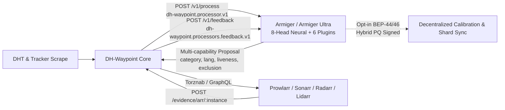

# Integrating Armiger & Armiger Ultra with DH-Waypoint

[Armiger](https://github.com/spencernorton/armiger) (`NorviTech/armiger` and `NorviTech/armiger-ultra` on Hugging Face) is the official neural classification, swarm-viability, and safety-gating processor suite for **DH-Waypoint**.

DH-Waypoint runs as a standalone, model-independent Go backend (`ghcr.io/spencernorton/dh-waypoint`) and communicates with Armiger over the versioned, deadline-bounded [`dh-waypoint.processor.v1`](processors/v1.md) HTTP contract. You can register, shadow-test, promote, drain, or roll back Armiger at runtime without rebuilding or restarting DH-Waypoint.



---

## 1. Choosing Between `Armiger` (INT8 CPU) and `Armiger Ultra` (FP32 + 6 Plugins)

Both variants are shipped in [`spencernorton/armiger`](https://github.com/spencernorton/armiger) and speak the identical `dh-waypoint.processor.v1` wire protocol:

| Variant | Artifact & Footprint | Latency (p50 / Batch-64) | Capabilities & Bundled Plugins | Recommended Deployment |
|---|---|---|---|---|
| **Armiger (`int8`)** | `armiger.int8.onnx` (`8.3 MB`) | `2.44 ms` single-item / `3.07 ms` batch-64 (CPU) | 8-head byte-level RoPE Transformer + File-Tree Encoder (`category`, `adult`, `junk`, `anime`, `english_subs`, `lang`, `owner_scope`, `title_language`) + Mondrian conformal safety gates (`calibration.json`). | Low-power CPU hosts, NAS boxes, or high-rate pre-filtering before heavier stages. |
| **Armiger Ultra (`fp32`)** | `armiger_ultra.fp32.onnx` (`32.3 MB`) + `swarm_adapter.pt` (`132 KB`) + `validated_zero_cue_catalog.json` (`26.0 MB`) | `0.21 ms/item` RTX GPU / `0.29 ms/item` Apple Silicon MPS / `1.12 ms` CPU single-item | Full-precision 8-head classifier plus all **6 official plugins**:<br>1. `SwarmSurvivalNet` (`100%` fake-seeder malware trap recall, `96.83%` warehouse swarm AUROC)<br>2. `SwarmPriors` (4-pathway Empirical Bayes tracker priors)<br>3. `ZeroCueCatalog` (`929,400` `BLAKE2b-64` title/year/anime entries)<br>4. `AudioLanguageGuard` (`97.80%` English-vs-Foreign audio disambiguation)<br>5. `CalibrationAndDHT` (`BEP-44`/`BEP-46` hybrid PQ-signed weight/temperature hot-reload + 500-canary gate)<br>6. `ArmigerDHTDBSync` + `CSAMGuard` (pre-ingest CSAM/abuse blocking & signed tombstones) | Primary classification, liveness, and policy engine for production DH-Waypoint instances. |

---

## 2. Quickstart: Docker Compose + Drag-In Plugin File

### Step 1: Launch DH-Waypoint + PostgreSQL + Armiger Ultra

From a clone of `DH-Waypoint`:

```bash
cp examples/.env.example .env
# Set a strong POSTGRES_PASSWORD and PROCESSORS_ADMIN_TOKEN in .env
mkdir -p plugins
cp examples/plugins/07-armiger-ultra.plugin.yml plugins/

docker compose -f examples/armiger-processor/docker-compose.yml --env-file .env up -d
```

### Step 2: Verify Plugin Registration & Readiness

DH-Waypoint reconciles `./plugins/*.plugin.yml` every 30 seconds (`PROCESSORS_PLUGINS_DIR=/plugins`). Verify that `armiger-ultra` is registered, healthy, and recording shadow proposals:

```bash
docker compose -f examples/armiger-processor/docker-compose.yml exec dh-waypoint dh-waypoint plugin list
docker compose -f examples/armiger-processor/docker-compose.yml exec dh-waypoint dh-waypoint plugin test http://armiger-ultra:8095
```

Or query the operator status API directly:

```bash
curl -s http://localhost:3333/api/processors/v1/registry/armiger-ultra   -H "Authorization: Bearer ${PROCESSORS_ADMIN_TOKEN}" | jq .
```

### Step 3: Promote from `shadow` to `apply`

Every plugin template starts in `mode: shadow` so you can inspect `dh_waypoint_processors_outcomes_total` and compare proposals against Core's deterministic pipeline before mutating catalogue rows. Once verified, edit `plugins/07-armiger-ultra.plugin.yml` and change `mode: shadow` to `mode: apply` (or promote via `PATCH /api/processors/v1/registry/armiger-ultra`).

---

## 3. Drag-In Plugin File & Operator API Registration

### Option A: Declarative Plugin File (`plugins/07-armiger-ultra.plugin.yml`)

```yaml
id: armiger-ultra
driver: http
mode: apply
state: active
priority: 20
endpoint: http://armiger-ultra:8095
auth_env: DH_WAYPOINT_PROCESSOR_TOKEN_ARMIGER_ULTRA
selector:
  excluded: false
learning:
  enabled: true
  mode: online_calibrate
  accepted_tiers:
    - operational_receipt
    - teacher_consensus
    - verified_import
    - human_gold
  push_enabled: true
configuration:
  variant: fp32
  enable_zero_cue_catalog: true
  enable_audio_language_guard: true
  enable_swarm_survival: true
  enable_csam_guard: true
  mondrian_junk_threshold: 0.36
  mondrian_adult_threshold: 0.42
  honeypot_trap_threshold: 0.50
```

Validate the file locally before deployment:

```bash
dh-waypoint plugin validate plugins/07-armiger-ultra.plugin.yml
```

### Option B: Authenticated Operator API (`PUT /api/processors/v1/registry/armiger-ultra`)

For programmatic lifecycle management with compare-and-swap (`expected_generation`) protection and pinned artifact digests:

```bash
curl -s -X PUT http://localhost:3333/api/processors/v1/registry/armiger-ultra   -H "Authorization: Bearer ${PROCESSORS_ADMIN_TOKEN}"   -H "Content-Type: application/json"   -d '{
    "expected_generation": 0,
    "driver": "http",
    "endpoint": "http://armiger-ultra:8095",
    "mode": "shadow",
    "state": "active",
    "priority": 20,
    "auth_env": "DH_WAYPOINT_PROCESSOR_TOKEN_ARMIGER_ULTRA",
    "selector": {
      "excluded": false
    },
    "learning": {
      "enabled": true,
      "mode": "online_calibrate",
      "accepted_tiers": [
        "operational_receipt",
        "teacher_consensus",
        "verified_import",
        "human_gold"
      ],
      "push_enabled": true
    },
    "configuration": {
      "variant": "fp32",
      "enable_zero_cue_catalog": true,
      "enable_audio_language_guard": true,
      "enable_swarm_survival": true,
      "enable_csam_guard": true
    }
  }'
```

To stack both the fast `8.3 MB` INT8 model and `Armiger Ultra` in a two-tier cascade, register `armiger` at `priority: 10` (`selector: {excluded: false}`) and `armiger-ultra` at `priority: 20` with `selector: {excluded: false, min_uncertainty: 0.18}`. Torrents resolved with high confidence by the `8.3 MB` INT8 pass skip the second pass automatically (`selector_skipped`).

---

## 4. Whole-Pipeline Admission Policy (`dh-waypoint.processors.admission.v1`)

DH-Waypoint controls what percentage of discovered torrents enter the optional processor queue via a deterministic SHA-256 cohort hash (`algorithm: "sha256-seed-infohash-v1"`, domain separator `dh-waypoint.processors.admission.v1
<seed>
<info_hash>`):

- `basis_points: 0` pauses optional processor admission without stopping DHT crawling or deterministic Core classification.
- `basis_points: 1000` admits a deterministic 10% cohort (ideal for initial capacity sizing).
- `basis_points: 10000` admits 100% of eligible torrents.

Inspect or update the admission policy via the Operator API:

```bash
# Read current admission policy
curl -s http://localhost:3333/api/processors/v1/admission   -H "Authorization: Bearer ${PROCESSORS_ADMIN_TOKEN}" | jq .

# Admit 100% of eligible torrents (10000 basis points)
curl -s -X PUT http://localhost:3333/api/processors/v1/admission   -H "Authorization: Bearer ${PROCESSORS_ADMIN_TOKEN}"   -H "Content-Type: application/json"   -d '{
    "expected_generation": 1,
    "seed": "production-v1",
    "basis_points": 10000,
    "policy_version": "v1",
    "reason": "Enable full Armiger Ultra admission"
  }'
```

---

## 5. Wire Contract Mapping (`dh-waypoint.processor.v1`)

When DH-Waypoint dispatches `POST /v1/process` to Armiger, it provides a single `v1.Job` containing both file-tree metadata and public-safe swarm observations:

1. **File & Structural Inputs (`input.name`, `input.size`, `input.files`, `input.file_count`, `input.extension`):**
   - Featurized by `armiger_inference.py` into 11 zero-tokenizer tensors (`title_bytes`, `ext_ids`, `file_sizes_log`, `file_depths`, `file_flags`, `file_mask`, `struct_feats`, `tracker_ids`, `cat_hint_id`, `tag_ids`, `swarm_feats`).
2. **Swarm & Priors Inputs (`input.sources`, `input.swarm`):**
   - DH-Waypoint passes `tracker_scraped`, `tracker_known`, `tracker_seeders`, `tracker_leechers`, `tracker_completed`, `dht_seeders`, `dht_leechers`, `liveness_status`, and title-derived `outcome_priors` (`PriorObservation` Beta $(lpha, eta)$ counts).
   - Credential-bearing tracker URLs and private passkeys are stripped by Core before dispatch and double-checked by `SwarmPriors.is_public_safe_source`.
3. **Multi-Capability `Result.Proposal`:**
   - Armiger advertises `capabilities: ["classify", "extract", "language", "policy"]` in `GET /v1/manifest` and returns a unified `v1.Proposal` in a single HTTP round-trip:
     - `content_type`: Maps Armiger's 11-class category (`movie`, `tv_show`, `music`, `audiobook`, `ebook`, `comic`, `game`, `software`, `course`, `xxx`, `unknown`) to DH-Waypoint's canonical content types (`0.00%` category flip guarantee across seeder counts).
     - `language`: Populated by `AudioLanguageGuard` (`audio`, `subtitles`, `english_audio`, `evidence: "metadata_claim"`).
     - `liveness`: Populated by `SwarmSurvivalNet` (`SwarmResidualAdapter`) and `SwarmPriors`.
     - `add_tags` & `weights`: Attaches calibrated confidence scores (`armiger:viability`, `armiger:category_conf`, `armiger:anime`) that downstream `Selector.ScoreThresholds` and Torznab priors can consume.
     - `exclusion`: Proposed when `CSAMGuard`, Mondrian `junk`/`adult`/`owner_scope` conformal gates, or `SwarmSurvivalNet`'s fake-seeder honeypot trap detector (`100.0%` recall on disguised `.exe`/`.scr`/`.lnk` malware) triggers.

---

## 6. 4-Tier Closed-Loop Feedback (`dh-waypoint.processors.feedback.v1`)

When Armiger returns `request_feedback: true` on a `v1.Result`, DH-Waypoint joins downstream ground-truth events back to the original prediction and delivers `v1.FeedbackBatch` (`contract: "dh-waypoint.processors.feedback.v1"`) to Armiger's `POST /v1/feedback` endpoint (or exposes it via `GET /api/processors/v1/feedback?processor_id=armiger-ultra&after_seq=<N>`):

| Feedback Tier (`v1.FeedbackTiers`) | Source in DH-Waypoint | How Armiger Ultra Uses It (`ArmigerDHTRSIEngine`) |
|---|---|---|
| `operational_receipt` | Core validation outcome (`applied`, `rejected_ambiguous`, `rejected_policy`). | Tracks distribution drift and schema/policy rejection rates per execution generation. |
| `teacher_consensus` | Multi-processor / teacher agreement on shadow or sampled cohorts. | Updates soft-label calibration buffers without overriding verified physical imports. |
| `verified_import` | `*arr` grab + import webhooks (`POST /evidence/arr/:instance`) and `qBittorrent` completion state (`import_succeeded`, `import_failed`). | Updates per-head temperature scaling ($T_h$), Mondrian conformal thresholds (`calibration.json`), and Empirical Bayes release-group priors. |
| `human_gold` | Explicit operator overrides and curated benchmark freezes (`eval-freeze`). | Highest-precedence ground truth; updates the local golden canary suite and (when opt-in `BEP-44`/`BEP-46` publishing is enabled) contributes to anonymized differential-privacy telemetry bundles. |

---

## 7. Conformal Safety Gates & Environment Reference

### DH-Waypoint Core Processor Variables

| Variable | Default | Purpose |
|---|---|---|
| `PROCESSING_MODE` | `basic` | `basic` stamps coarse file-extension categories in Core and delegates full classification to registered plugins; `full` runs Core's built-in classifier first; `raw` skips Core classification. |
| `PROCESSORS_PLUGINS_DIR` | `/plugins` | Directory reconciled every 30 seconds for `*.plugin.yml` files. |
| `PROCESSORS_ADMIN_TOKEN` | *(empty)* | Bearer token required for `/api/processors/v1/*` operator endpoints (`503` when unset). |
| `DH_WAYPOINT_PROCESSOR_TOKEN_<NAME>` | *(empty)* | Outbound Bearer token sent by DH-Waypoint to the processor service referenced by `auth_env`. |

### Armiger Processor Service Variables & Conformal Knobs

| Variable / Configuration Key | Default | Purpose |
|---|---|---|
| `ARMIGER_VARIANT` / `configuration.variant` | `fp32` | `fp32` loads `armiger_ultra.fp32.onnx` (`32.3 MB`); `int8` loads `armiger.int8.onnx` (`8.3 MB` CPU fast-path). |
| `enable_zero_cue_catalog` | `true` | Enables the `929,400`-entry `BLAKE2b-64` title/year/anime disambiguation catalog (`validated_zero_cue_catalog.json`). |
| `enable_audio_language_guard` | `true` | Enables cross-head `title_language` $	imes$ `lang` audio & anime dub disambiguation (`audio_language_guard.py`). |
| `enable_swarm_survival` | `true` | Enables the 48-tensor `SwarmResidualAdapter` (`swarm_adapter.pt`) for swarm viability and fake-seeder honeypot detection. |
| `enable_csam_guard` | `true` | Enforces multi-stage pre-ingest CSAM/CSAE blocking and signed `SHA-256` tombstone checks (`csam_guard.py`). |
| `mondrian_junk_threshold` | `0.36` | Calibrated Mondrian conformal threshold for `junk` exclusion (`100.00%` precision on `oct15_confirmation`). |
| `mondrian_adult_threshold` | `0.42` | Calibrated Mondrian conformal threshold for `adult`/`xxx` namespace isolation. |
| `honeypot_trap_threshold` | `0.50` | Threshold on `SwarmSurvivalNet` honeypot probability above which disguised malware swarms are excluded. |
| `ARMIGER_DHT_RSI_MODE` | `pull_only` | `off`, `pull_only` (verifies hybrid `Ed25519`+`WOTS+-SHAKE256` signatures, 3-of-5 distinct-ASN quorum, and 500-canary gate before hot-reloading weights), or `opt_in_contribute` (exports $arepsilon$-differentially private telemetry bundles encrypted with `X25519`+`ML-KEM-768`+`ChaCha20-Poly1305`). |
| `ARMIGER_DHT_DB_SYNC_MODE` | `off` | `off`, `subscribe` (pulls encrypted sharded catalog updates for selected `(category, language, quality)` tuples with `xxx` off by default), or `publish`. |

---

## 8. Observability & Rollback

Monitor Armiger's latency, queue wait, and proposal outcomes through DH-Waypoint's Prometheus `/metrics` endpoint and the bundled [`observability/grafana-dashboards/dh-waypoint.json`](../observability/grafana-dashboards/dh-waypoint.json) dashboard:

- `dh_waypoint_processors_attempts_total{processor_id="armiger-ultra",generation}`
- `dh_waypoint_processors_outcomes_total{processor_id="armiger-ultra",generation,stage,outcome}`
- `dh_waypoint_processors_request_duration_seconds_bucket{processor_id="armiger-ultra",stage}`
- `dh_waypoint_processors_queue_wait_seconds_bucket{processor_id="armiger-ultra",stage}`

To pause or roll back Armiger at any time without restarting DH-Waypoint:

1. Set `mode: shadow` or `state: paused` in `plugins/07-armiger-ultra.plugin.yml` (or via `PATCH /api/processors/v1/registry/armiger-ultra`).
2. Existing catalogue entries and their provenance receipts remain intact; pausing or removing a plugin never deletes catalogue history or interrupts Torznab serving.
