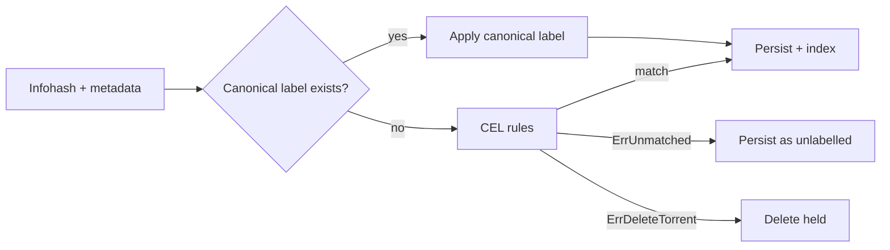

# Classification

Classification assigns each torrent a content type (`movie`, `tv_show`, `music`, etc.) and, where it can, an identity such as a TMDB title. How much of that runs in the core is set by `PROCESSING_MODE`:

| Mode | What the core does |
|---|---|
| `basic` (default) | Stamps a coarse content type from the byte majority of file extensions. No metadata providers, no network calls. |
| `full` | Runs the canonical-label preempt and the CEL classifier below, with title parsing and TMDB matching. |
| `raw` | Stores metainfo untouched; neither the classifier nor the content filter runs. |

Anything heavier runs outside the core as an optional [processor](../processors/plugin-files.md): a separate HTTP service whose proposals the core validates before applying them. The in-core LLM stage of earlier releases is retired; see [connecting an LLM](../processors/llm.md).



## Canonical-label preempt

Source: `internal/classifier/runner_canonical.go`.

A canonical label is a content-type label backed by ground truth — specifically, a successful `*arr` grab. When Sonarr grabs `Game.of.Thrones.S01E14.1080p.WEB-DL.mkv`, the evidence pipeline records that this exact infohash was identified as TV S01E14 of Game of Thrones. That row in `torrent_canonical_labels` is canonical: not a guess, an observation.

On every classifier run, the runner first checks `torrent_canonical_labels` by infohash. On hit, the canonical label is applied verbatim and the rest of the chain is skipped. On miss or lookup error, the chain falls through to the CEL rules — availability dominates over preempt benefits, so a transient DB blip doesn't break classification.

Metrics: `dh_waypoint_classifier_preempt_preempted_total`, `dh_waypoint_classifier_preempt_constrained_total`, `dh_waypoint_classifier_preempt_misses_total` and `dh_waypoint_classifier_preempt_lookup_errors_total`.

The preempt hit ratio rises as your `*arr` clients accumulate grab history. On a DHT-heavy workload most torrents have no label yet, so misses are the expected steady state.

## CEL classifier

Source: `internal/classifier/runner_canonical.go` (decorator) wraps the CEL runner in `internal/classifier`.

[CEL](https://github.com/google/cel-spec) (Common Expression Language) is Google's lightweight, sandboxed rules language. DH-Waypoint's classifier ships with a curated CEL rule set — patterns over title, file paths, file size, file extension, and BEP-9-derived metadata.

Examples of the kinds of signals the rules look at:

- Title contains `S01E14` → TV episode
- Title regex matches `(\d{4})\s*(1080p|720p|2160p)` → release year + resolution
- File extension `.mp3` / `.flac` / `.wav` → music
- File extension `.epub` / `.azw3` / `.mobi` → ebook
- Size in expected range for the content type — a 50 MB "movie" is suspicious

Rules execute in deterministic priority order. The first match wins; the classifier exits immediately and the label is persisted.

Two terminating errors are special:

- `ErrUnmatched` — no rule fired. The torrent is persisted with no content-type label.
- `ErrDeleteTorrent` — the rule chain rejected this torrent (e.g., the `keywords.banned` regex caught a CSAM-class title). Catalogue removal is disabled in current releases, so the delete is held and counted by `dh_waypoint_classifier_delete_held_total`; nothing is removed ([catalogue removal](../OPERATIONS.md#catalogue-removal)).

You can inspect the rules:

```bash
dh-waypoint classifier show --format yaml
```

The bundled rules merge with an optional `classifier.yml` in the config directory (`/root/.config/bitmagnet/classifier.yml` in the container), then one in the working directory, so you can extend or override them without rebuilding. After a rule change, run `dh-waypoint reprocess` to apply it to already-indexed torrents.

## Where labels surface

- **Torznab** — `<newznab:attr name="category" value="2040"/>` on each item.
- **GraphQL** — `TorrentContent.contentType` field; aggregations expose facet counts.

## Reprocessing

After editing CEL rules, run reprocess to re-classify already-indexed torrents:

```bash
dh-waypoint reprocess
```

It queues the work through the job queue, so it can be interrupted and resumed. `dh-waypoint reprocess --help` lists its filters.

## See also

- [Concepts / DHT crawler](dht-crawler.md)
- [Concepts / Wantbridge](wantbridge.md) — wants are derived from `*arr` grabs and reuse the canonical-label table
- [Reference / CLI](../reference/cli.md) — `classifier show`, `reprocess`
- [Reference / Metrics](../reference/metrics.md)
- [Configuration](../configuration.md)
