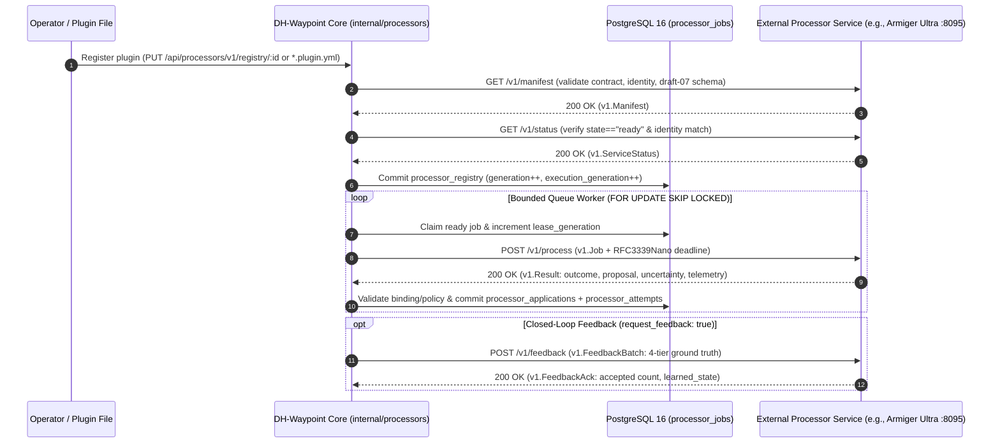

# DH-Waypoint External Processor HTTP Webhook Contract Reference

This document is the complete normative reference for building, operating, and integrating an external processor service (such as **[Armiger / Armiger Ultra](armiger-integration.md)**) with **DH-Waypoint**.

- **Primary Processing Contract:** `dh-waypoint.processor.v1`
- **Closed-Loop Feedback Contract:** `dh-waypoint.processors.feedback.v1`
- **Source of Truth in Go:** [`processorapi/v1/types.go`](../processorapi/v1/types.go), [`processorapi/v1/validate.go`](../processorapi/v1/validate.go), [`processorapi/v1/feedback.go`](../processorapi/v1/feedback.go), [`internal/processors/transport.go`](../internal/processors/transport.go)
- **JSON Schema & Fixtures:** [`docs/processors/v1.schema.json`](processors/v1.schema.json), [`docs/processors/fixtures/`](processors/fixtures/)



---

## 1. HTTP Transport, Headers & Wire Framing Rules

DH-Waypoint's `Transport` (`internal/processors/transport.go`) enforces strict, deterministic HTTP/1.1 framing on every request to an external processor endpoint:

### Endpoint & Connection Rules
- **Allowed Schemes:** `http://` or `https://` only. URLs containing embedded userinfo (`user:pass@`), query strings (`?...`), fragments (`#...`), or exceeding `1024` bytes are rejected (`invalid_endpoint`).
- **Redirects Forbidden:** Any HTTP `3xx` redirect response immediately aborts the request with `redirect_forbidden`.
- **Connection Pooling:** `MaxConnsPerHost: 16`, `MaxIdleConns: 16`, `IdleConnTimeout: 30s`, `DisableCompression: true` (prevents zip-bomb amplification).

### HTTP Request & Response Headers

| Header | Direction | Requirement & Semantics |
|---|---|---|
| `Content-Type` | Request & Response | Must be `application/json` (UTF-8). Any response whose media type is not `application/json` is rejected with `invalid_content_type`. |
| `Authorization` | Request (Outbound from Core) | Optional `Bearer <secret>`. Configured via `auth_env` on the registration (`^DH_WAYPOINT_PROCESSOR_TOKEN_[A-Z0-9_]{1,64}$`). Core resolves the secret from the environment variable `os.Getenv(auth_env)` or from `/run/secrets/dh-waypoint-processors/<auth_env>` (up to `4096` bytes). Model or provider API keys never enter Core. |

### Wire-Level JSON Validation (`v1.Decode`)
Every request and response body is parsed through a two-pass strict decoder (`processorapi/v1/validate.go`):
1. **Hard Byte Cap:** Maximum payload size is `262,144` bytes (`256 KiB`, `v1.MaxBody`). Payloads exceeding `256 KiB` fail with `body_too_large` / `request_too_large`.
2. **Nesting Depth Cap:** Maximum JSON AST depth is `32` (`json_depth`).
3. **No Duplicate Keys:** Any JSON object containing duplicate keys at the same level fails immediately with `duplicate_key` (preventing parser-differential attacks).
4. **No Unknown Fields or Trailing Data:** `DisallowUnknownFields()` is enforced on all structs, and any bytes after the root JSON value fail with `trailing_json`.
5. **Finite Numbers Only:** `NaN`, `+Inf`, and `-Inf` are rejected across all numeric fields.

---

## 2. Service Endpoints Overview

An external processor service implements three mandatory endpoints and one optional feedback endpoint:

| Method & Path | Request Body | Response Body | Purpose |
|---|---|---|---|
| `GET /v1/manifest` | *(empty)* | `v1.Manifest` | Declares immutable processor identity, supported `capabilities`, informational `qualification`, and a self-contained JSON Schema draft-07 (`configuration_schema`, max `16 KiB`, no `$ref`). |
| `GET /v1/status` | *(empty)* | `v1.ServiceStatus` | Reports process instance ID, startup timestamp, readiness state (`warming`, `ready`, `draining`, `unavailable`), lifetime outcome counters, and resource telemetry. |
| `POST /v1/process` | `v1.Job` | `v1.Result` | Evaluates a single torrent job synchronously before `deadline` and returns a structured verdict (`outcome` + optional `proposal`). |
| `POST /v1/feedback` | `v1.FeedbackBatch` | `v1.FeedbackAck` | *(Optional)* Receives batched 4-tier ground-truth feedback (`operational_receipt`, `teacher_consensus`, `verified_import`, `human_gold`) when `learning.push_enabled: true`. |

---

## 3. Request Payload Schema (`POST /v1/process` — `v1.Job`)

When DH-Waypoint dispatches a job to `POST /v1/process`, the JSON request body conforms to `v1.Job`:

```json
{
  "contract": "dh-waypoint.processor.v1",
  "job_id": "9f86d081884c7d659a2feaa0c55ad015a3bf4f1b2b0b822cd15d6c15b0f00a08",
  "input_revision": "4b227777d4dd1fc61c6f884f48641d02b4d121d3fd328cb08b5531fcacdabf8a",
  "pipeline_revision": "ef2d127de37b942baad06145e54b0c619a1f22327b2ebbcfbec78f5564afe39d",
  "configuration_digest": "e7f6c011776e8db7cd330b54174fd76f7d0216b612387a5ffcfb81e6f0919683",
  "processor": {
    "id": "armiger-ultra",
    "version": "2.1.0",
    "model_version": "armiger-ultra-2.1.0",
    "policy_version": "conformal-v2.1",
    "artifact_digest": "7b2a9d4e8c1f0a3b5d6e7f8a9b0c1d2e3f4a5b6c7d8e9f0a1b2c3d4e5f6a7b8c"
  },
  "stage": "classify",
  "capabilities": ["classify", "extract", "language", "policy"],
  "configuration": {
    "variant": "fp32",
    "enable_zero_cue_catalog": true,
    "enable_audio_language_guard": true,
    "enable_swarm_survival": true,
    "enable_csam_guard": true
  },
  "deadline": "2026-10-18T22:00:10.000000000Z",
  "input": {
    "info_hash": "0123456789abcdef0123456789abcdef01234567",
    "name": "Example.Show.S01E01.1080p.WEB-DL.DDP5.1.H.264-GROUP",
    "size": 1845493760,
    "files": [
      {
        "path": "Example.Show.S01E01.1080p.WEB-DL.DDP5.1.H.264-GROUP.mkv",
        "size": 1845493760
      }
    ],
    "file_count": 1,
    "extension": "mkv",
    "files_complete": true,
    "deterministic": {
      "processing_outcome": "completed",
      "content_type": "unknown",
      "title": "Example Show",
      "year": 2026,
      "match": null,
      "matching_outcome": "not_attempted"
    },
    "candidates": [],
    "prior_results": [],
    "accumulated_scores": {},
    "accumulated_tags": [],
    "sources": [
      {
        "source": "dht",
        "seeders": 14,
        "leechers": 3
      }
    ],
    "swarm": {
      "tracker_scraped": true,
      "tracker_known": true,
      "tracker_seeders": 28,
      "tracker_leechers": 4,
      "tracker_completed": 112,
      "dht_seeders": 14,
      "dht_leechers": 3,
      "liveness_status": "alive",
      "outcome_priors": [
        {
          "key_type": "release_group",
          "key_value": "GROUP",
          "alpha": 42,
          "beta": 2
        }
      ]
    }
  }
}
```

### Field Constraints on `v1.Job` & `v1.Input`

| Field | Type | Bounds & Validation Rules |
|---|---|---|
| `contract` | `string` | Must equal `"dh-waypoint.processor.v1"`. |
| `job_id`, `input_revision`, `pipeline_revision`, `configuration_digest` | `string` | Lowercase 64-hex-character SHA-256 digests (`^[a-f0-9]{64}$`). |
| `processor` | `v1.Identity` | Token fields (`id`, `version`, `model_version`, `policy_version`) match `^[a-zA-Z0-9][a-zA-Z0-9._+-]{0,95}$`. `artifact_digest` is `"none"` or `^[a-f0-9]{64}$`. |
| `stage` | `v1.Stage` | One of `"classify"`, `"extract"`, `"match"`, `"language"`, `"policy"`, `"embed"`. |
| `capabilities` | `[]v1.Stage` | Optional list of active capabilities when executing a multi-capability processor in a single pass. |
| `configuration` | `json.RawMessage` | JSON object (`<= 4096` bytes) validated against `Manifest.ConfigurationSchema`. Must never contain secret/credential keys (`password`, `secret`, `apikey`, `token`, `authorization`). |
| `deadline` | `string` | RFC3339 / RFC3339Nano UTC timestamp by which the processor must finish or abort work. |
| `input.info_hash` | `string` | Lowercase 40-hex-character SHA-1 infohash (`^[a-f0-9]{40}$`). |
| `input.name` | `string` | Non-empty UTF-8 torrent name (`1..4096` bytes). |
| `input.size` | `int64` | Total byte size (`>= 0`). |
| `input.files` | `[]v1.File` | Up to `256` deterministically sorted file entries (`path` `<= 4096` bytes, `size >= 0`). Check `files_complete` and `file_count` rather than `len(files)` when the file inventory was truncated. |
| `input.deterministic` | `v1.Deterministic` | `processing_outcome` in `completed\|deferred\|not_attempted`; `matching_outcome` in `matched\|completed_unmatched\|deferred\|not_attempted`. |
| `input.candidates` | `[]v1.Candidate` | Up to `32` Core-supplied candidate media entities for `match` stage selection. |
| `input.prior_results` | `[]v1.Result` | Up to `96` prior step results in the current pipeline plan. |
| `input.sources` & `input.swarm` | Public-Safe Swarm Hints | Up to `32` `SourceObservation` entries and `SwarmInput` (`<= 32` `OutcomePriors`). Enforced by `privateSourceGuard` and `passkeyQueryGuard`: credential-bearing tracker URLs and private indexer names are stripped and rejected. |

---

## 4. Response Verdict Schema (`v1.Result` & `v1.Proposal`)

The processor responds to `POST /v1/process` with HTTP `200 OK` and a `v1.Result` JSON payload:

```json
{
  "contract": "dh-waypoint.processor.v1",
  "job_id": "9f86d081884c7d659a2feaa0c55ad015a3bf4f1b2b0b822cd15d6c15b0f00a08",
  "input_revision": "4b227777d4dd1fc61c6f884f48641d02b4d121d3fd328cb08b5531fcacdabf8a",
  "pipeline_revision": "ef2d127de37b942baad06145e54b0c619a1f22327b2ebbcfbec78f5564afe39d",
  "configuration_digest": "e7f6c011776e8db7cd330b54174fd76f7d0216b612387a5ffcfb81e6f0919683",
  "processor": {
    "id": "armiger-ultra",
    "version": "2.1.0",
    "model_version": "armiger-ultra-2.1.0",
    "policy_version": "conformal-v2.1",
    "artifact_digest": "7b2a9d4e8c1f0a3b5d6e7f8a9b0c1d2e3f4a5b6c7d8e9f0a1b2c3d4e5f6a7b8c"
  },
  "stage": "classify",
  "outcome": "completed",
  "proposal": {
    "content_type": "tv_show",
    "extraction": {
      "title": "Example Show",
      "year": 2026,
      "season": 1,
      "episodes": [1],
      "video_resolution": "1080p",
      "video_source": "WEB-DL",
      "video_codec": "H.264",
      "release_group": "GROUP",
      "is_anime": false
    },
    "language": {
      "audio": ["eng"],
      "subtitles": ["eng"],
      "evidence": "metadata_claim",
      "english_audio": "present"
    },
    "liveness": {
      "seeders": 28,
      "leechers": 4,
      "completed": 112,
      "observation": "live",
      "source": "armiger_swarm_survival"
    },
    "add_tags": ["armiger:verified", "armiger:high_viability"],
    "weights": {
      "armiger_viability": 0.964,
      "armiger_category_conf": 0.992
    }
  },
  "reasons": ["conformal_set_singleton", "swarm_survival_live"],
  "uncertainty": 0.008,
  "evidence": [
    {
      "kind": "conformal_p_value",
      "reference": "tv_show:0.992"
    }
  ],
  "retry_after_seconds": 0,
  "telemetry": {
    "observed_at": "2026-10-18T22:00:00.125000000Z",
    "inference_ms": 0.29,
    "rss_bytes": 419430400,
    "cpu_milliseconds": 1.15
  },
  "request_feedback": true
}
```

### Verdict Outcomes (`v1.Outcome`)

| Outcome | Proposal Allowed? | Retry Delay Allowed? | Meaning & Core Action |
|---|---|---|---|
| `completed` | **Required** (`proposal != nil`) | No (`0`) | Processor proposes one or more positive enrichment fields (`content_type`, `extraction`, `match`, `language`, `liveness`, `add_tags`, `remove_tags`, `weights`, `embedding`). |
| `excluded` | **Required** (`proposal.exclusion != nil`, `scope: "publication"`) | No (`0`) | Processor proposes a reversible publication restriction (requires `policy` capability). Records a row in `processor_exclusions`; never deletes catalogue rows. |
| `abstained` | Forbidden (`null`) | No (`0`) | Processor has no opinion (or uncertainty exceeds its conformal threshold). Core advances to the next step with no penalty. |
| `unmatched` | Forbidden (`null`) | No (`0`) | Valid **only** when `match` capability is active and `input.deterministic.matching_outcome == "completed_unmatched"`. Certifies an exhaustive negative candidate search. |
| `deferred` | Forbidden (`null`) | Optional (`0..3600s`) | Temporary capacity or upstream dependency delay. Core re-queues the step for retry up to `MaxAttempts`. |
| `failed` | Forbidden (`null`) | No (`0`) | Technical failure inside the processor. Recorded in `processor_attempts` and counted by `technical_failure_window_*`. |

### Proposal Validation Bounds (`v1.Proposal`)
- **`content_type`:** Must be one of `"movie"`, `"tv_show"`, `"music"`, `"ebook"`, `"audiobook"`, `"comic"`, `"game"`, `"software"`, `"xxx"`.
- **`extraction`:** `title` `<= 512` chars, `year` `0..2200`, `season` `0..1000`, `episodes` up to `100` entries (`0..10000`), `anime_absolute_episode` `0..100000`, `release_group` `<= 128` chars.
- **`match`:** Must select an offered candidate from `input.candidates` (`unoffered_candidate` otherwise).
- **`language`:** Up to `16` ISO 639-1/2 lowercase 2–3 letter codes (`^[a-z]{2,3}$`) in `audio` and `subtitles`; `evidence` must be `"metadata_claim"` or `"verified_reference"`.
- **`add_tags` / `remove_tags` / `weights`:** Up to `32` tags matching `^[a-zA-Z0-9][a-zA-Z0-9._:-]{0,63}$` and up to `32` finite weights in `[-1000.0, 1000.0]`.
- **`exclusion`:** `scope` must be `"publication"` and `reason` must be `1..128` chars.
- **`embedding`:** `space` token and `1..2048` finite `float64` values.
- **`reasons` / `evidence` / `trace`:** Up to `8` `reasons` (`<= 256` chars each), up to `8` `evidence` items (`kind <= 64`, `reference <= 512`), and optional `trace` JSON (`<= 65,536` bytes).

---

## 5. Timeouts, Retries, Leases & Circuit-Breaker Semantics

### Bounded Attempt Timeouts (`RequestTimeout` & `Deadline`)
- Core configures `RequestTimeout` (default `10s`, configurable within `100ms..60s` in `internal/processors/config.go`).
- On every dispatch, Core computes `deadline = time.Now().UTC().Add(RequestTimeout)` and embeds it in `Job.Deadline` (`RFC3339Nano`) while binding the same deadline to the HTTP request context and `ResponseHeaderTimeout`.
- The processor service **must** abort computation by `deadline` even if the TCP disconnect is not immediately observed. Late responses cannot be applied because the PostgreSQL lease will have expired or advanced.

### PostgreSQL Lease Fencing & Retry Backoff
- Jobs in `processor_jobs` are claimed via `FOR UPDATE SKIP LOCKED` with a monotonic `lease_generation` and bounded `lease_until` timestamp.
- Each pipeline step may be attempted up to `MaxAttempts` times (default `3`, configurable `1..5`).
- If the processor returns HTTP `429 Too Many Requests`, HTTP `503 Service Unavailable`, network timeout (`transport_failed`), or `outcome: "deferred"`, Core increments `step_attempts` and reschedules `available_at` using `retry_after_seconds` (clamped to `0..3600s`).
- Once `step_attempts` reaches `MaxAttempts`, a deferred or unreachable step settles terminally as `deferred` or `failed`, and execution advances so a wedged processor never blocks the queue forever.

### 500-Attempt Technical Failure Window & Health Monitoring
- Core tracks a strict rolling population of the latest **500 terminal attempts** for the current `execution_generation` (`internal/processors/attempt_window.go`, `technical_failure_window_*` and `technical_failure_prefix_*`).
- Background health polling (`GET /v1/status`) marks a processor `unknown` if more than **2 minutes** elapse without a valid observation.
- Operators (or automated admission controllers) can throttle admission via `PUT /api/processors/v1/admission` (`basis_points: 0..10000`) or transition a degraded processor to `state: "paused"` / `state: "draining"` via `PATCH /api/processors/v1/registry/:id`.

---

## 6. Idempotency, Cryptographic Binding & Strict-v1 Fallback

1. **Cryptographic Binding Equality:**
   - Core generates `job_id`, `input_revision`, `pipeline_revision`, and `configuration_digest` as SHA-256 digests over the canonical input, active pipeline plan, and plugin configuration.
   - `Result.Validate(job)` verifies `reflect.DeepEqual(result.Binding, job.Binding)`. Any mismatch in `job_id`, `input_revision`, `pipeline_revision`, `configuration_digest`, `processor`, or `stage` is rejected with `binding_mismatch`.
   - *Stateless Webhook Convenience:* If a minimal webhook omits the top-level `binding` fields in its JSON response, `Result.FillDefaultBinding(job)` automatically copies the dispatched `Job.Binding` before validation.
2. **Idempotent Retries & Lease Generations:**
   - Retries of the same step reuse the exact `job_id` and `input_revision` (updating only `deadline`), so processor-side caches keyed on `(job_id, input_revision, configuration_digest)` are 100% safe and idempotent.
   - When Core commits a step result to PostgreSQL, it checks `WHERE job_id = $1 AND lease_generation = $2`. Stale or duplicate worker deliveries after a crash or lease expiry are atomically rejected.
3. **Automatic Multi-Capability to Single-Stage Fallback (`processStrictV1`):**
   - By default, Core sends a single multi-capability `POST /v1/process` request containing `capabilities: [...]` when a processor advertises multiple stages.
   - If a strict single-stage v1 implementation returns HTTP `400 Bad Request`, `Transport.Process` (`internal/processors/transport.go`) automatically records the endpoint in `strictEndpoints` and transparently falls back to `processStrictV1`, dispatching one request per stage (`classify`, `extract`, etc.) and merging the resulting proposals.

---

## 7. Fail-Open vs. Fail-Closed Semantics

DH-Waypoint separates **indexer availability** from **catalogue mutation authority** so that external processor failures are always safe:

| Dimension | Mode (` Fail-Open ` vs ` Fail-Closed `) | Exact Architectural Behavior |
|---|---|---|
| **Core Crawling & Torznab Serving** | **Fail-Open** (Resilient Availability) | If an external processor times out, crashes, or returns `503`, DH-Waypoint's DHT crawler, BEP-9 fetcher, CEL classifier, TMDB matcher, and Torznab/GraphQL APIs continue running at full speed without interruption. |
| **Shadow Mode (`mode: "shadow"`)** | **Fail-Closed for Mutation** (Zero Catalogue Writes) | Proposals from `shadow` processors are validated and recorded in `processor_jobs` and Prometheus metrics (`dh_waypoint_processors_outcomes_total`), but **never** modify `torrent_contents` or `processor_exclusions`. |
| **Apply Mode (`mode: "apply"`) Enrichment** | **Fail-Closed on Step Failure/Deferral** | In an `apply`-mode pipeline, if an earlier enrichment step terminates as `failed` or `deferred`, Core withholds new positive catalogue enrichment from the unfinished pipeline rather than applying partial or unvalidated metadata. Existing eligible catalogue rows remain served. |
| **Core Authority & Precedence** | **Fail-Closed Against Override** | Core deterministic facts and canonical `*arr` ground-truth labels always win (`internal/processors/apply.go`). A processor proposal can only populate unset fields and cannot overwrite a verified canonical label or attach an unoffered candidate (`unoffered_candidate`). |
| **Policy Exclusions & Curation** | **Fail-Closed for Safety / Reversible** | A processor failure **never** grants eligibility to an excluded torrent and **never** deletes a torrent. An `excluded` verdict writes a reversible restriction to `processor_exclusions` (`scope: "publication"`), hiding the item from Torznab while preserving full recovery snapshots. |
