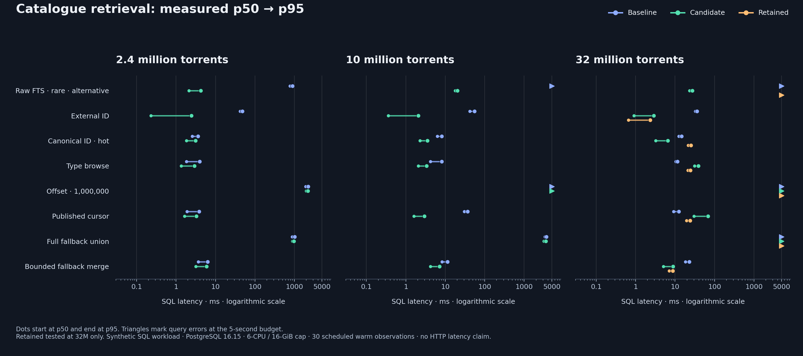
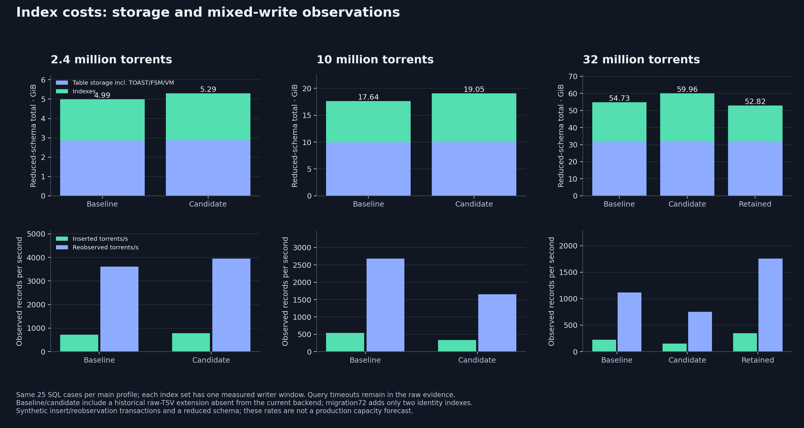
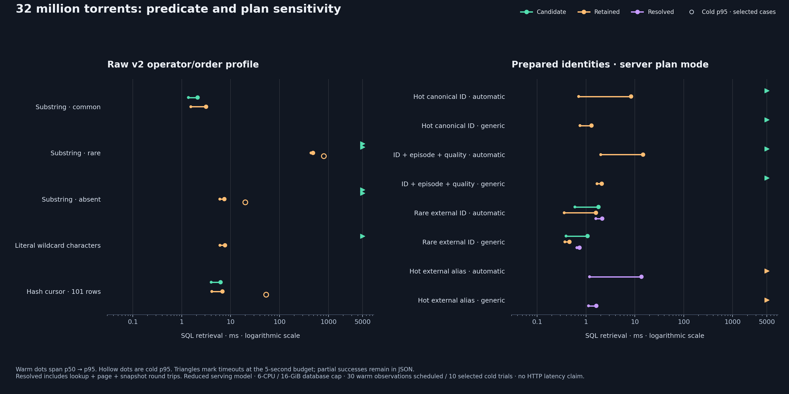

# Synthetic catalogue qualification — 2026-10-24

This run measures PostgreSQL query and index alternatives on the same invented
catalogue. It does not compare complete search engines, measure HTTP latency,
classify real releases or establish production capacity. The
[design record](../../design/catalogue-search.md) explains the authority and
serving boundaries; the [harness](../../../scripts/catalogue_bench/README.md)
contains reproducible commands.

## Population and execution

Completed primary scales are 2.4M, 10M and 32M torrents, with 5.64M, 23.5M
and 75.2M file rows. Each has a `scale_complete` receipt in the raw suite events. Results at each scale use the same deterministic prefix, with one
content projection per torrent and 2.35 file rows per torrent: 95% single-file,
4% ten-file and 1% hundred-file records. Five percent share a hot identity; the
tail spans about one million identities. Seventy percent have accepted mappings;
the remainder is split equally among stale proposals, uncertain proposals and
missing proposals. The attributed proposals are separate from canonical facts.

The database was PostgreSQL 16.15, capped at six CPU cores and 16 GiB RAM with
no extra swap, 2 GiB shared buffers, 16 MiB work memory, 512 MiB maintenance
memory and durable WAL settings. Four workers populate the fixture. Large growth
rebuilds secondary query indexes afterward while retaining primary/unique/FK
constraints; steady ingestion is measured with the complete tested index set.
The client process is outside the database container's resource accounting.

The schema models relevant search indexes and serving predicates. It does not
install the complete production schema or account for every history table,
snapshot receipt, index or content sibling. The hashes are 20-byte synthetic
identities; mixed v1/v2 widths and file-heavy populations need separate tests.
Raw-name retrieval includes a missing-content-projection regression.

## Index sets and queries

Baseline models relevant catalogue B-tree/GIN indexes and adds a synthetic raw
TSV column with the initial schema's historical B-tree. Migration6 removed that
raw column/index from the real backend; this experiment does not install the
current application schema. Candidate adds raw
TSV GIN, complete published and typed-page B-trees, an external-ID reverse
index and whole-episode GIN. Selected is a subsequent experiment that replaces
the raw TSV experiment with migration 00071's name trigram GIN, removes the
unused raw B-tree and episode GIN, and adds ordered canonical-ID lookup.
Retained removes the wider published/typed browse indexes from that experiment.
Migration 00072 contains only ordered canonical-identity and partial external-ID
indexes. Up/Down touch only those two new indexes. Migration 00071 owns raw name
trigrams. Only baseline/candidate were tested at every scale; selected and
retained were additional 32M experiments.

The fixed main mix has 25 SQL cases: hash, canonical and external identity,
common/rare/missing full-text terms, type, resolution, season/episode/pack,
grouping, deep offset, tuple cursor and full/bounded unknown fallback. Every
case applies the reduced current privacy/quarantine/adult model before LIMIT.
Thirty warm observations are scheduled per case; four query workers repeat the
mix alongside actual source reobservations and inserts. A synthetic tail is
removed afterward, in FK order, and the exact initial population is restored.

Variants run sequentially with the same scheduled case mix and random seed.
Timeouts change the executed work and writer windows have different durations.
The observed writer rates are neither an isolated estimate of index overhead
nor a production capacity forecast.

REST v2 uses escaped literal `ILIKE`, canonical-hash order and `limit + 1`.
Its separate substring profile tests common, rare, absent and literal-wildcard
queries with 101-row retrieval. TSV measurements are an alternative query,
not a measurement of that API. Prepared probes test automatic/custom/generic
plans and a combined canonical-ID/episode/quality predicate, recording server
plan counters. Forcing a generic plan does not prove that automatic mode chose
it in an application.

The supplemental v2 probes also use raw serving's direct private-field check;
the original raw-query model retains a redundant private self-semijoin. The
models represent the same eligible set but can produce different plans. Even
the supplemental profile models only the reduced quarantine/adult checks,
not the complete application policy or HTTP/hydration work. The raw cursor
probe uses the API's 101-row hash order without a count.

## Observations and decision

The evidence supports selective identity lookup and a smaller retained index
set. It does not support a blanket low-latency claim for every query.

- At 2.4M, warm external-key p95 fell from 47.5 to 2.4 ms with the candidate
  indexes; at 10M it fell from 54.9 to 2.1 ms. The candidate's 10M published
  cursor was 2.9 ms p95, while the million-row offset exceeded five seconds.
  At 32M, the retained rare external-key statement was 2.4 ms p95 versus
  baseline 36.2 ms. These are literal SQL statements, not complete API calls.
- The wider candidate regressed at 32M: published cursor p95 was 68.3 ms versus
  baseline 12.4 ms, and type browse 38.8 versus 11.6 ms. Its plans used parallel
  gather/merge with extra policy probes below the gather. Dropping those browse
  indexes did not restore baseline latency in this sequential experiment:
  retained cursor/type p95 were 24.0/24.3 ms. The retained set is not claimed to
  improve all browse queries. Wider indexes are excluded from migration 00072.
- Prepared plans exposed failures hidden by literal SQL. With the initial
  candidate, automatic hot-ID execution completed four timed samples, then
  timed out and skipped 25; forced generic failed during warmup. Combined
  ID/episode/quality failed in all modes. Ordered canonical lookup in the
  retained set completed all 30 samples in every mode: forced-generic p95 was
  1.3 ms for hot ID and 2.1 ms for the combined predicate. Automatic p95 was
  8.4 and 14.7 ms respectively. Server plan counters are retained.
- A hot external alias still timed out during warmup in every mode on the
  retained indexes. Resolving a singleton canonical key and reading its page
  in one read-only repeatable-read transaction completed all 30 observations
  per mode. Composite p95, including transaction and lookup round trips, was
  13.7 ms automatic, 13.0 ms custom and 1.6 ms generic. An unmapped alternate
  ID and a second ID for the same canonical key also passed. Two distinct
  resolved keys still timed out in all modes; their complete OR semantics
  remain intact and further optimization is pending. The Go service uses the
  snapshot method for external/multiple IDs; typed TMDB retains direct lookup.
- Raw v2's reduced substring model needs the trigram index: rare and absent
  queries timed out without it. With retained indexes, literal warm p95 was
  485.9 ms rare, 7.5 ms absent and 6.8 ms for the 101-row raw hash cursor.
  Corresponding file-cache cold p95 was 808.5, 20.0 and 53.4 ms. Automatic and
  forced-custom rare substring plans completed, but forced generic rare/absent
  plans still timed out. This known limitation is not hidden by the literal
  chart. The profile does not install a new raw API query strategy.
- Raw TSV GIN made the alternative 32M rare-token query 27.2 ms p95 where
  baseline timed out. It is excluded from the retained set because the shipped
  raw API uses literal substring semantics. Legacy FTS probes consequently
  time out in the retained mix. A whole-episode GIN was also rejected because
  it did not serve the application's JSON subexpression predicate.
- Bounded classified-plus-unknown fallback preserved the exact first page and
  reduced 32M candidate p95 from the full-union path to 8.9 ms. It remains a SQL
  prototype. The backend does not promote unknown text candidates into ID
  matches or ship that fallback in this change.

The reduced-schema totals before the timed profiles were 4.99/5.29 GiB at 2.4M
and 17.64/19.05 GiB at 10M for baseline/candidate. At 32M they were 54.73/59.96
GiB, with 52.82 GiB for retained (21.00 GiB indexes). Removing the large unused
TSV B-tree from the synthetic extension is part of that reduction. The current
backend already removed it in migration6, so these totals do not predict a
production storage decrease from migration72. It adds two indexes to the current
schema. These experimental totals exclude WAL, temporary sort/build files,
client memory and production-only tables.

The 32M main concurrent writer observed 225 inserts/s plus 1,119 reobserved
records/s for baseline, 154 plus 754 for candidate, and 351 plus 1,755 for
retained. Windows lasted 30.21, 20.83 and 31.92 seconds respectively. At 10M,
corresponding baseline/candidate rates were 538/2,679 and 334/1,658. The unequal
windows, timeout-dependent executed mix, retained churn and shared host prevent
interpreting these as isolated causal index costs or capacity forecasts.

On the quiescent 32M corpus, concurrent construction took 514.0 seconds for raw
name trigrams, 41.5 seconds for the ordered canonical index and 0.87 seconds for
the reverse external-key index. Retained reused these valid indexes after
removing the rejected browse indexes; near-zero `IF NOT EXISTS` transition
times are not rebuild times. Full reduced-schema offline reindex took 359.6,
554.0 and 641.3 seconds for baseline, candidate and retained. These single
sequential observations do not prove retained reindex is intrinsically slower;
index operators, I/O and shared-host cache state differ. An intermediate wider
experiment's reindex was intentionally canceled after its query regressions;
its decision receipt is retained and no completion is claimed for it.

The retained quiescent forced-kill/restart/exact-count check took 5.0 seconds,
preserving all 32M rows and the fixture sentinel. This is not a backup restore
or an in-flight transaction durability test. In the retained warm stage,
sampled Docker working set peaked at 3.24 GiB while cgroup charged memory
reached the 16 GiB cap; its median CPU sample used about 1.5 cores. Report both
memory measures. Full sampled stages and missing coverage are in the resource
summary.

Download [the raw synthetic evidence and frozen sources](evidence.json),
[all latency/cost/correctness summaries](summary.json) and
[the sampled resource summary](resource-summary.json). The evidence manifest
pins every UTF-8 member by SHA-256. It includes failed queries, skipped observations,
eviction receipts, exact SQL plans, source hashes and the interrupted
experiments. It contains invented metadata only.

## Correctness and measurement limits

Complete `EXCEPT` comparisons run in both directions for equivalent query
shapes. The bounded fallback must preserve the exact first page and ordering.
An independent modular-arithmetic oracle checks complete rare, hot-alias and
combined-filter pages, including incorrectly empty results. A saved-evidence
replay verified 2,460 sample digests across 192 files with zero mismatches;
see [the oracle receipt](oracle-verification.json) and `verify_evidence.py`. Core serving and actual
request-option regressions run separately against PostgreSQL in CI. Accepted
IDs retain complete type/source/id namespaces; uncertain candidates never gain
an identity claim from text. ID-only requests cannot certify unmapped records;
the raw catalogue remains separately searchable without a plugin.

Measured SQL statements have a five-second budget. A timed-out warmup skips
that case's later observations; worker timeouts and skipped observations remain
visible. Quantiles include successful observations only, with failures and
sample counts beside them. Nearest-rank p99 is effectively the maximum at
30 warm or 10 cold observations. These samples cannot establish a service SLO.
The cursor anchor is resolved outside the timer. Offset and cursor timings
describe traversal methods, not the same page position.

Each cold observation stops only the labeled disposable container, applies
`POSIX_FADV_DONTNEED` to its dedicated PostgreSQL volume, restarts it, then
executes one first-touch query. The operation does not drop host-wide caches;
storage-device caches remain uncontrolled. Eviction receipts are retained.

Resource sampling is approximately every seven seconds, including Docker's
sampling latency. Docker working set excludes inactive file cache. Charged
cgroup memory and peak include that cache; those counters were added late in
the 10M run, so earlier coverage remains missing. Short stages can have no
resource sample. CPU percentage uses 100% per core, with a six-core cap.
The host and storage are shared; unrelated host I/O is not experimentally controlled.

Reindex timings use offline `REINDEX SCHEMA` on the reduced schema. Concurrent
index construction is measured on a quiescent synthetic corpus; it does not
qualify construction under live ingestion. Recovery is a quiescent forced kill,
restart and exact row-count/sentinel check, including count time. It does not
measure restoration from backup, in-flight transaction loss or HA failover.

Full-chain PostgreSQL integration caught an initial migration72 rollback that
tried to recreate the synthetic raw TSV index on the real schema. The raw column
was already removed by migration6. The corrected migration changes only its two
new identity indexes; current-schema Up/Down and the full migration downgrade
suite verify that existing evidence-retention holds remain effective.

Setup/correctness/maintenance use budgets separate from measured queries.
Development failures included an unsuitable initial query shape, insufficient
tail-cleanup and cursor-anchor budgets, and a 180-second full-set comparison
timeout at 32M. A repeat was interrupted before timing to remove duplicate
complete-set computation. Full validation then uses 600 seconds and materializes
each set once; timed queries retain five seconds. These were
corrected before resumed final stages; no failed setup is labeled a completed
scale. Stage hashes and frozen source retain the implementation changes.

No 100M run, full HTTP/DHT throughput test, long-term bloat study or BitMagnet,
SQLite or OpenSearch engine head-to-head was performed. A different engine's
performance and synchronization/rebuild cost remain unqualified.
